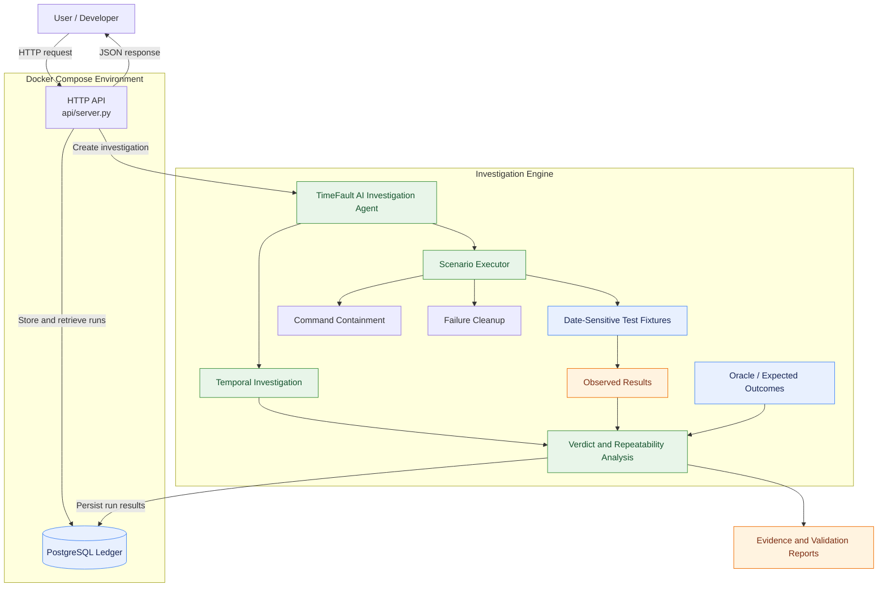

# TimeFault AI
### Temporal Bug Investigation & Evidence-Based Verification

TimeFault AI is a date-sensitive software debugging workbench that investigates how application behavior changes over time. It executes scenarios under controlled dates, compares observed outcomes against an oracle, investigates potential failure windows, and produces structured evidence to support its verdicts.

## 🎯 Key Features

- **Temporal Investigation:** Test candidate dates to identify date-dependent failures.
- **Oracle-Based Verification:** Compare observed behavior with expected scenario outcomes.
- **Repeatability Analysis:** Distinguish repeatable failures from flaky or inconclusive results.
- **Command Containment:** Block selected dangerous commands before guest execution.
- **Failure Cleanup:** Invoke cleanup operations through `finally` blocks.
- **Evidence Generation:** Preserve investigation results, traces, and validation reports.
- **REST API:** Create and retrieve investigation runs over HTTP.
- **PostgreSQL Ledger:** Persist run records and investigation status.

## 🏗️ System Architecture



### Architecture Components

| Component | Responsibility |
|---|---|
| Investigation Agent | Coordinates scenario execution and investigation logic. |
| Temporal Investigation | Explores candidate dates and potential failure windows. |
| Scenario Executor | Runs configured test scenarios and captures outcomes. |
| Oracle | Provides expected outcomes for verdict comparison. |
| Verdict Analysis | Evaluates outcomes and repeatability. |
| Command Containment | Blocks selected dangerous commands. |
| Failure Cleanup | Invokes cleanup operations after execution failures. |
| HTTP API | Exposes endpoints for health checks and investigation runs. |
| PostgreSQL Ledger | Stores run records and results. |
| Evidence Reports | Preserve benchmark, reliability, and validation artifacts. |

## 🛠️ Technology Stack

- **Language:** Python
- **API:** HTTP REST API
- **Database:** PostgreSQL
- **Containerization:** Docker and Docker Compose
- **Testing:** Python `unittest`
- **Evidence Formats:** JSON, JSONL, Markdown, and SQL

## 📁 Project Structure

```text id="ofcv2o"
timefault-celesto/
├── agent/              # Investigation, execution, and verdict logic
├── api/                # HTTP API server
├── fixtures/           # Date-sensitive and control scenarios
├── oracle/             # Expected scenario outcomes
├── tests/              # Unit tests
├── seeds/              # Database initialization SQL
├── reports/            # Benchmark and validation evidence
├── logs/               # Command audit and containment evidence
├── tools/              # Fixture generation utilities
├── Dockerfile
├── docker-compose.yml
├── .env.example        # Safe configuration template
├── .gitignore
└── README.md
```

## 🚀 Getting Started

### Prerequisites

- Python 3
- Docker
- Docker Compose
- Valid credentials for any external services you intend to use

### 1. Clone the repository

```bash
git clone https://github.com/Laharisrikotipalli/timefault-celesto.git
cd timefault-celesto
```

### 2. Configure environment variables

Create a local environment file from the example:

```bash
cp .env.example .env
```

Edit `.env` and enter your own credentials where required. Never commit `.env` or expose API keys in source code, logs, screenshots, or public reports.

### 3. Start the application

```bash
docker compose up -d --build
```

### 4. Check API health

```bash
curl -i http://127.0.0.1:8000/health
```

Use the host port configured in `docker-compose.yml` if it differs from `8000`.

### 5. Create an investigation run

```bash
curl -i -X POST http://127.0.0.1:8000/api/runs \
  -H 'Content-Type: application/json' \
  -d '{"scenario_id":"E01"}'
```

### 6. List investigation runs

```bash
curl -sS http://127.0.0.1:8000/api/runs
```

### 7. Inspect database records

```bash
docker compose exec -T ledger psql -U timefault -d timefault \
  -c 'SELECT run_id, scenario_id, status, created_at FROM runs;'
```

The database username and database name must match your actual Compose and SQL configuration.

### 8. Stop the services

```bash
docker compose down
```

Add `-v` only if you intentionally want to remove the database volume and its persisted data.

## 🧪 Testing

Compile the Python modules:

```bash
python3 -m py_compile agent/*.py tests/*.py
```

Run the unit tests:

```bash
python3 -m unittest discover -s tests -v
```

Review the test output and corresponding reports to understand which behaviors were verified.

## 📊 Evidence and Validation

The `reports/` directory contains investigation and validation artifacts, including reliability results, failure traces, capability reports, and postmortem analysis.

These artifacts document tested scenarios, observed behavior, and investigation outcomes. Refer to individual reports for their methodology, results, and limitations.

## ⚠️ Limitations

- The lifecycle cleanup report uses mocked CLI operations. It does not prove real cloud-resource deletion or Ctrl+C cleanup.
- Local concurrency tests do not prove concurrent scheduling through the HTTP API.
- Results apply to the scenarios and configurations actually tested; they do not guarantee detection of every possible temporal bug.
- External-service behavior depends on the configured environment and credentials.

## 🔒 Security

- Keep `.env` out of version control.
- Use `.env.example` as a template with placeholder values only.
- Rotate credentials that may have been exposed.
- Review logs and reports before publishing to ensure they contain no secrets or sensitive information.

## 📌 Project Goal

TimeFault AI aims to make date-sensitive software failures easier to investigate through controlled execution, oracle-based verification, repeatability analysis, and evidence-backed reporting in a single workflow.
